# PuckBug

**A hockey scorebug and broadcast graphics overlay for OBS Studio** that runs itself from the rink's **TimeToScore** live scoreboard. Built for junior and amateur hockey streams (USPHL NCDC out of the box; any league scored on TimeToScore works): no typing scores during the game.

PuckBug reads the rink's live scoreboard (score, clock, period, shots, penalty clocks, goal and penalty announcements), the game sheet, rosters, season stats and league scores, and draws:

- a **scorebug** with the game clock, shots, power play / penalty kill, 4-on-4, 5-on-3, 3-on-3 overtime, empty net and shootout;
- **goal and penalty announcements** (scorer, assists, PPG/SHG/ENG, hat tricks), a **POWER PLAY** announcement, and milestones;
- **lineups**, **scores around the league** and a **ticker** along the bottom;
- full-screen **cards**: matchup, pregame stats, period and final summary, three stars, player of the game, team leaders, standings, schedule;
- **instant replay** with OBS (slow motion, a replay library, highlight reels);
- **sponsor ads and "presented by" moments** (playlists, lower thirds, full-screen breaks);

in one of fifteen themes, every color adjustable. The operator corrects anything by hotkey or from a browser panel (on the streaming PC, or a laptop or iPad), and airs the rest when it fits. Or the optional **Auto director** does it.

Runs on **Windows 10/11** and **macOS 12+**, entirely from its own folder: no accounts, no cloud. **[Download the latest release](../../releases/latest)**: Windows installer, Apple Silicon and Intel Macs.

- **[Broadcaster guide](docs/BROADCASTER-GUIDE.md)**: game night start to finish; what's automatic, what's on demand, and what the Auto director does.
- **[OBS setup](OBS-SETUP.md)**: scenes, sources and remote control, once per computer.

---

## What it looks like

From a recorded game replayed through PuckBug, with the made-up teams and players of the demo's league (the Northpeak Junior Hockey League), except where noted.

### The scorebug

| | |
|---|---|
|  |  |
| **During play:** score, shots, period, clock | **Goal:** the scorer and assists from the scorekeeper's announcement |
|  |  |
| **Penalty:** player and infraction | **Power play / penalty kill:** this season's and tonight's PP% and PK% when an advantage starts |
| 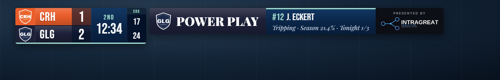 | |
| **POWER PLAY announcement** (the home team's, after the penalty announcement), here presented by a sponsor (demo view) | |
|  | 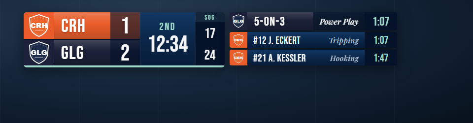 |
| **4-on-4** | **5-on-3** (demo view) |
|  |  |
| **Misconduct** (the scorekeeper's "Placeholder" shows the type) | **3-on-3 overtime** |
|  |  |
| **Overtime winner** | **FINAL over OT** (or SO; plain FINAL after regulation) |
|  |  |
| **Shootout:** each attempt, the round, sudden death (demo view) | **Warm-ups** with the board's clock |
| 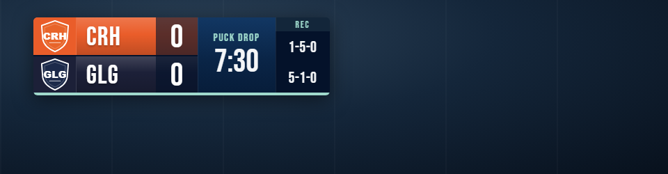 |  |
| **Puck drop** time and season records (demo view) | **Countdown** in the last hour (demo view) |

### Along the bottom

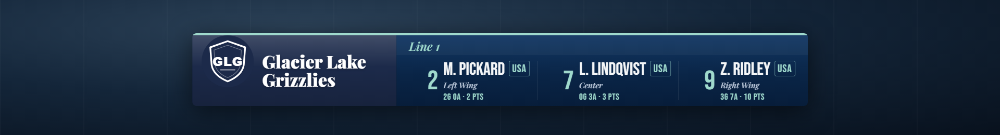

Live games on the scores band and ticker update as they happen: the score at once, the clock counting down on screen.

### Full-screen cards

| | |
|---|---|
|  |  |
| **Matchup** | **Pregame stats:** each side in its team's colors: records, coaches, leaders, goalies, head to head |
|  |  |
| **Team leaders:** points, goals, assists, PIM, SV%, GAA | **Period summary:** goals and shots by period, power plays, leaders, goalies, penalties |
|  |  |
| **Final summary** (FINAL/OT) | **Player of the game** |
|  |  |
| **Three stars:** tonight's top three from the game's stats | **Standings:** from each team's TimeToScore record, tonight's teams marked |
|  |  |
| **Upcoming schedule** | **Milestone:** a season mark reached tonight, waits in the panel until you push it live |

### Sponsors and ads

Sponsors' images and videos in playlists: full-screen breaks, lower thirds above the ticker, or a box in the corner. Play, play once, pause, next, stop after this item, stop in N minutes, or let a playlist start by itself at intermissions. Sponsored moments put a sponsor's logo ("PRESENTED BY") on the POWER PLAY announcement (with the sponsor's lower third before and after it), goals, shutouts, three stars, player of the game, summaries and more. Shown with the included sample ad.

| | |
|---|---|
| 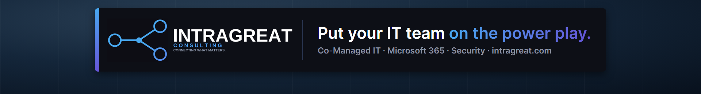 | 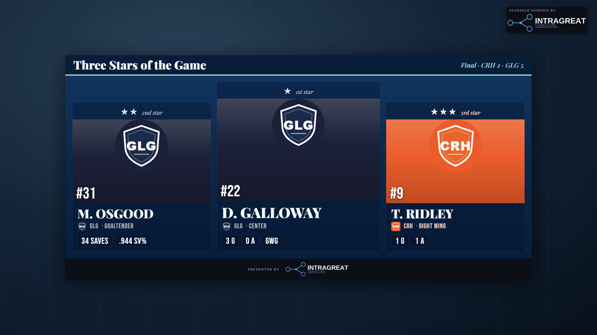 |
| **Lower third** | **Three stars**, presented by a sponsor |
| 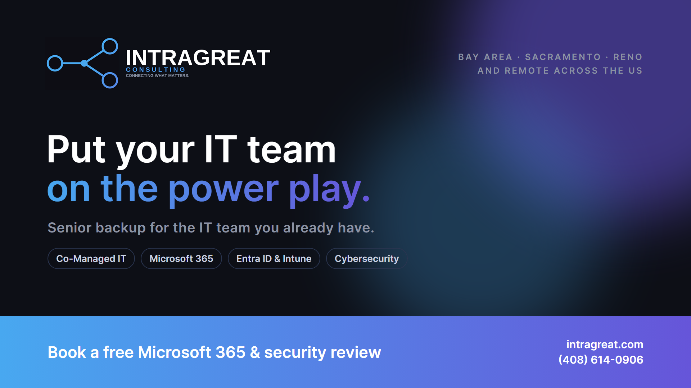 | 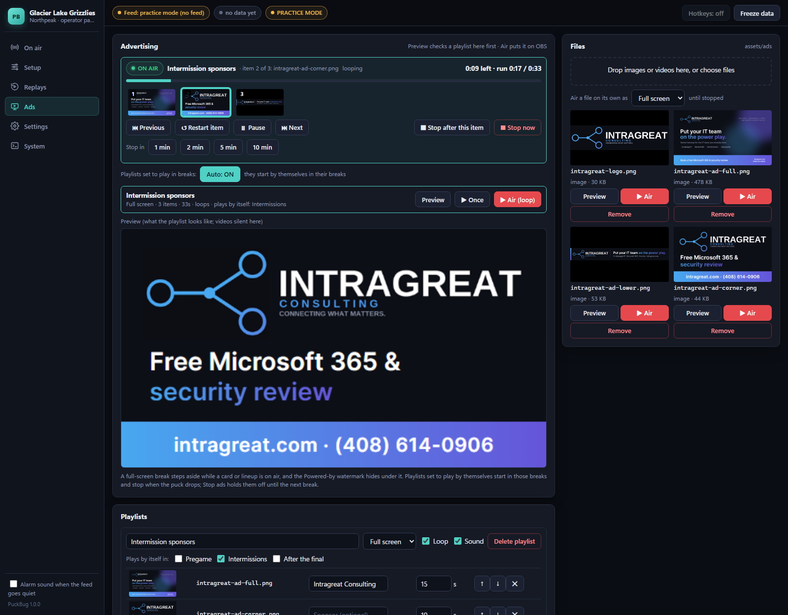 |
| **Full-screen break** | **The Ads tab:** now playing, controls, playlists |

### Themes

Fifteen, each with its own colors, edges and lettering, and every color adjustable (Setup → Look). Team Colors draws each team's parts in its own colors. **Lettering** also offers six sports font packages for any theme: Broadcast (Barlow Condensed), Arena (Big Shoulders), Stadium (Anton + Oswald), Velocity (Teko), Rink (Saira Condensed) and Varsity (Graduate + Oswald).

| | | | |
|---|---|---|---|
| 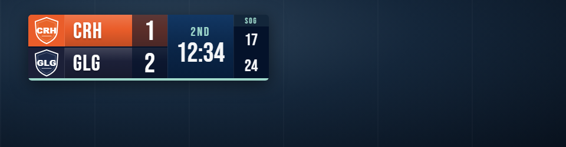 | 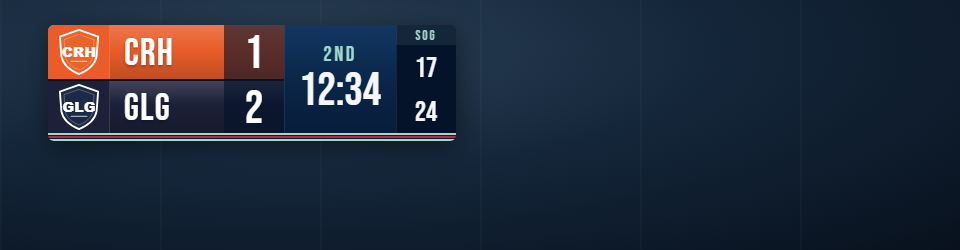 | 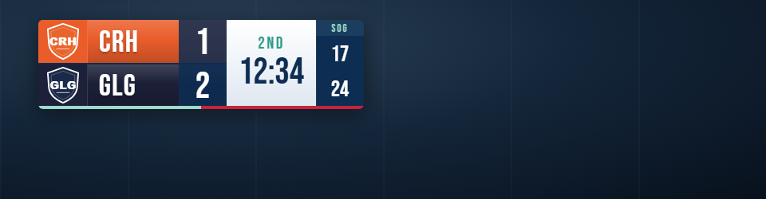 | 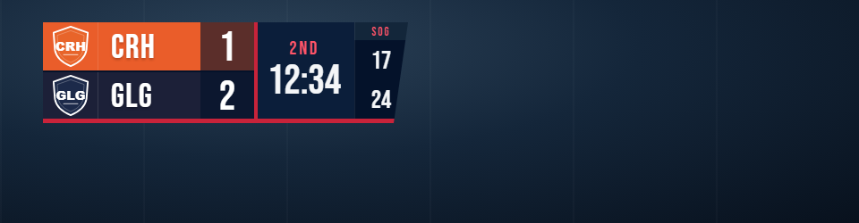 |
| 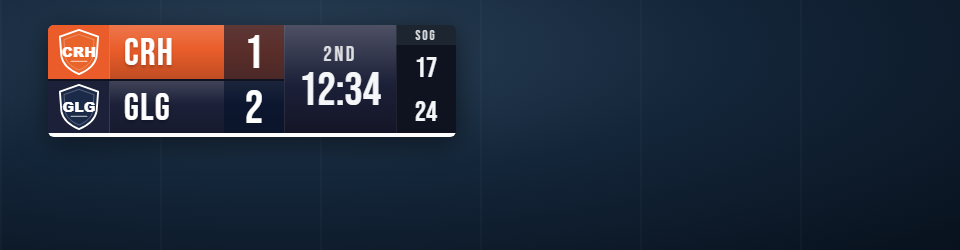 | 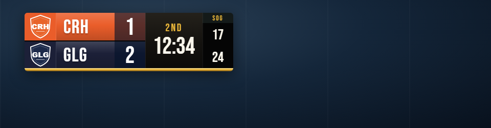 | 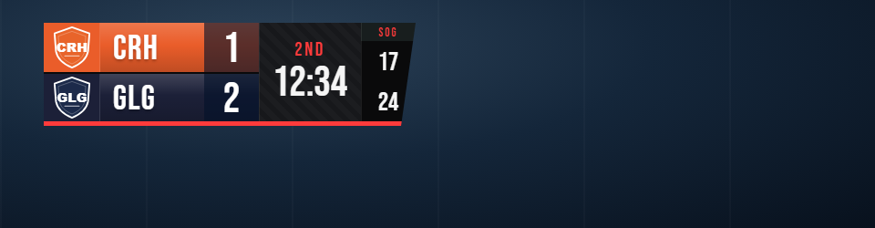 | 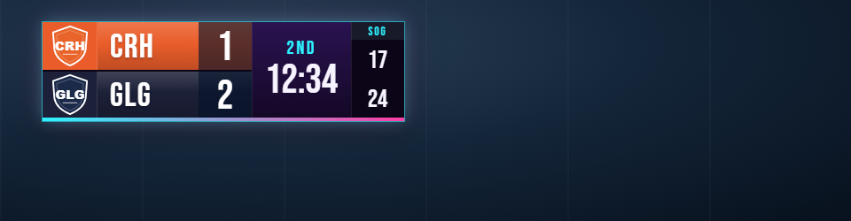 |

### The operator panel

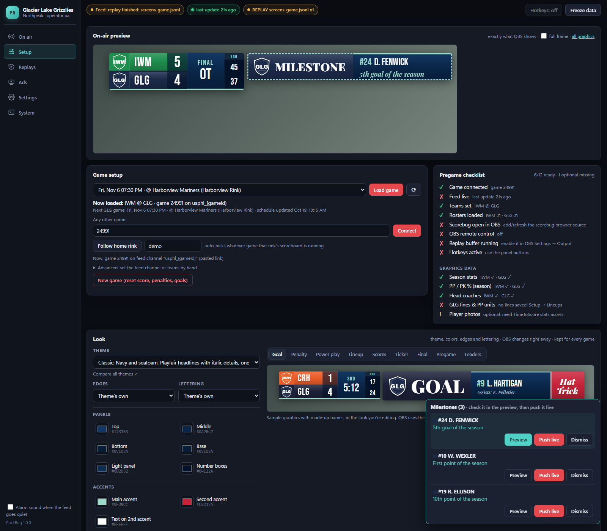
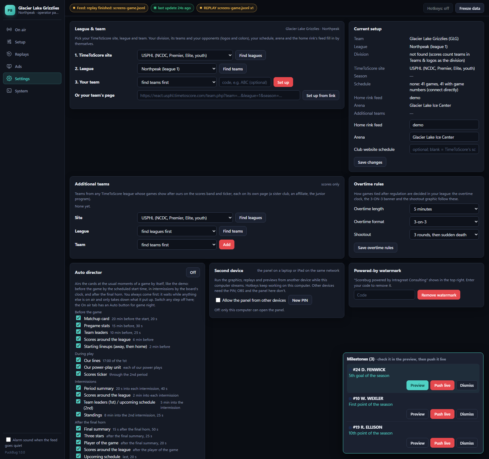

---

## Installing

### Windows

1. Download **PuckBug-Setup-….exe** from the release and double-click it. Nothing else to install: Node.js and everything PuckBug needs are inside. It installs for you alone (no administrator password), adds **PuckBug** to the Desktop and the Start menu (with **PuckBug Practice** and **PuckBug Demo**), and starts PuckBug.
   - Windows may say **"Windows protected your PC"** (the program isn't signed with a paid certificate): click **More info → Run anyway**.
   - **Smart App Control** (Windows 11) may refuse the installer outright, with no Run anyway. Turn it off under Windows Security → App & browser control → Smart App Control, or install on another PC. Once installed, PuckBug starts through the signed Node.js inside, which Smart App Control allows.
   - A newer setup installs over the old one and keeps your settings, teams, rosters, saved games, logs and recordings.
2. A PuckBug window opens, then the operator panel in your browser. Leave the window open: closing it stops PuckBug.
3. The first time, the panel opens on **Settings** to set up your team (below).

> **Or the zip:** **PuckBug-…-win-x64.zip** is the same, unpacked: extract it anywhere and double-click **start.bat** (or PuckBug.exe, which Smart App Control blocks). Node is inside it too.

Microsoft Edge (on every Windows PC) reads season stats and league scores in the background.

### Mac

1. Download the kit for your Mac from the release:
   - **PuckBug-…-mac-arm64.tar.gz** for Apple Silicon (Apple menu → About This Mac says "Chip: Apple M…");
   - **PuckBug-…-mac-x64.tar.gz** for Intel.
   
   Double-click it to unpack.
2. **First run only:** macOS blocks downloaded programs that aren't from the App Store. Right-click **start.command** → **Open** → **Open**. If it still refuses, open Terminal, type `xattr -dr com.apple.quarantine `, drag the PuckBug folder into the window, and press Enter.
3. Double-click **start.command**. Terminal opens, then the operator panel in your browser. Leave the Terminal window open: closing it stops PuckBug.
4. **Hotkeys:** allow Terminal under **System Settings → Privacy & Security → Accessibility** (and **Input Monitoring** if it's listed), then start PuckBug again. Without it, everything but the hotkeys works.
5. **Season stats and league scores** need **Microsoft Edge or Google Chrome** installed (either one; it runs in the background).

While PuckBug runs, the Mac stays awake (start.command keeps it from sleeping). A sleeping Mac drops the scoreboard feed. Plug it in, and use wired internet if you can.

The Mac kit isn't signed by Apple yet, which is why step 2 is needed. A signed app comes with the desktop app.

### Both

| | Windows | Mac |
|---|---|---|
| Game day | start.bat | start.command |
| Practice (no feed, separate saved game) | practice.bat | practice.command |
| Try a team setup beside a running game (port 8771) | setup.bat | `./start.command --sandbox --port 8771` |
| The demo: a recorded game with every graphic, by itself | demo.bat | demo.command |
| Replay a recording | `start.bat --replay recordings\file.jsonl --speed 10` | `./start.command --replay recordings/file.jsonl --speed 10` |

Then add PuckBug to OBS: **[OBS-SETUP.md](OBS-SETUP.md)** (the overlay is a browser source at `http://127.0.0.1:8770/overlay`, 1920×1080; set OBS to 60 fps).

### Updating and uninstalling

- **Updating:** run the new **PuckBug-Setup-….exe** (Windows) over the old one, or unpack the new Mac kit and copy your old kit's `config`, `data` and `assets\ads` folders into it. Your settings, teams, rosters, hotkeys, ads, saved games, logs and recordings carry over. Close PuckBug first.
- **Uninstalling:** close PuckBug and delete its folder (Windows: `%LOCALAPPDATA%\Programs\PuckBug` unless you chose another; Mac: wherever you unpacked it), and the PuckBug shortcuts on the Desktop and in the Start menu. It installs nothing else.

---

## Setting up your team (Settings tab)

**League & team:** PuckBug starts with the **USPHL NCDC** chosen: click **Find teams**, pick your team and click **Set up**. For another league:
1. **TimeToScore site:** USPHL, Sharks Ice or CAHA, or *Another TimeToScore site* (the X in `live.X.timetoscore.com`). Click **Find leagues**.
2. **League:** pick it and click **Find teams** (about a minute).
3. **Your team:** pick it and click **Set up**. Or paste your team's page from the league's stats site and click **Set up from link**.

Set up does the rest:
- **Division:** found from the league schedule.
- **Teams & logos:** your division's teams and your schedule's opponents, with logos and colors taken from the logos (change any under Setup → Teams & logos).
- **Schedule:** your season from TimeToScore with every game's number and start time.
- **Details:** your arena, the league's name and logo, and your home rink's scoreboard feed.
- **Stats and scores:** season stats, coaches, photos and league scores load.

Your corrections (arena name, rink feed, club schedule, additional teams) are remembered per team. While a game is loaded, Set up asks before changing the team.

**Current setup:** fix the home rink feed, the arena name, or use your club website's schedule instead of TimeToScore's (TimeToScore's is usually more accurate on start times).

**Additional teams (scores only):** a sister club, an affiliate, your junior program, from any TimeToScore league. Use Find leagues → Find teams → **Add**. Their games show after yours on the scores band and ticker, each on its own page with their league's logo.

**Overtime rules:** overtime length, format (3-on-3, 4-on-4, 5-on-5) and shootout rounds (3, 5 or none). The OT clock, the 3-on-3 banner and the shootout follow these.

**Auto director:** on or off, and which steps it airs. See the [broadcaster guide](docs/BROADCASTER-GUIDE.md#the-auto-director-optional).

**Hotkeys:** record new keys for any of them, add or remove them, or reset them to the defaults; saved hotkeys work at once. See the [broadcaster guide](docs/BROADCASTER-GUIDE.md#hotkeys).

**League without a stats site:** some rinks only run live scoreboards. Enter your team's name and code; the scorebug, clock, penalties, names and game-day rosters work, and you paste the game link on game day.

**Powered-by watermark:** the overlay shows "Scorebug powered by Intragreat Consulting" in the top right, clear of every other graphic. To remove it, enter your unlock code under **Settings → Powered-by watermark** (it stays off through restarts and updates). To get a code, contact Intragreat Consulting at [intragreat.com](https://intragreat.com).

**Sample ads:** the Ads tab starts with Intragreat Consulting's sample ad in three sizes (full screen, lower third, corner), so you can try playlists and sponsored moments straight away. Delete them when you have your own sponsors.

---

## Game day

1. Start PuckBug (start.bat / start.command).
2. **Setup tab → Game setup:** tonight's game is preselected from your schedule. Click **Load game**.
   - **Home games** follow your rink's scoreboard.
   - **Away games** connect straight to the game's own feed.
   - Any other game: paste its TimeToScore live link and click **Connect**.
3. Check the **Pregame checklist** (feed, teams, rosters, stats, OBS).
4. Press **New game** if the last game is still on the scorebug.

Then see the **[broadcaster guide](docs/BROADCASTER-GUIDE.md)**.

PuckBug saves everything as it goes. If the computer or the window dies mid-game, start it again and the game comes back. Announcements it missed are re-read from today's recording.

---

## Before you stream

PuckBug draws the graphics; whether you may stream a game is between you, your league and the rink. Before the first stream from a rink:

- **League and team rules:** many leagues have broadcast rules (an official streaming partner, or the home team's permission). Check yours.
- **The rink:** ask before setting up cameras and running cables.
- **Music:** commercial music played on the stream (between periods, say) can get the stream muted or taken down. Use music you have the rights to.
- **Sponsors' ads:** use images and videos the sponsor has given you to use.
- **Players' names:** they come from the league's own public game sheets; if a family asks for a player to be left out, fix the roster under Setup → Rosters.

## Where the data comes from

- **The live feed:** TimeToScore's public scoreboard feed, the same connection the rink's own live page opens. One connection per game, no polling, a second or two behind the rink.
- **Game-day rosters:** from the game's TimeToScore live page, read the way the page reads them.
- **Season stats, coaches, photos, standings, schedules and league scores:** from the league's TimeToScore stats site, opened in Edge or Chrome in the background, one page at a time, the way a visitor would.
- **Other games tonight:** their own live feeds, while they're live or starting within the hour.

Nothing is sent anywhere. Everything is kept in the PuckBug folder: `config` for settings, teams, rosters and stats; `data` for the saved game; `recordings` for every live game's feed; `logs` for troubleshooting.

## Rehearsing and checking

- **The demo** (demo.bat / demo.command) replays a recorded game between two made-up teams at 5× and runs every graphic by itself: about 20 minutes of the full package.
- **Practice** (practice.bat / practice.command) has no feed: drive everything from the panel and hotkeys.
- **Replays** of any recording: every live game is saved to `recordings/` automatically; `--replay <file> --speed 10`, add `--from mm:ss` to jump in. Replays keep their own saved game.

## License

PuckBug is free to download and use; it is not open source. See LICENSE.txt, and THIRD-PARTY-NOTICES.txt (in the download) for the open-source software and fonts it includes. PuckBug is not affiliated with TimeToScore, the USPHL or the NCDC.

## Troubleshooting

Every run writes **`logs/<date>.log`**: everything in the panel's Log, plus each change the scoreboard sends, every button and hotkey, and errors. When something looks wrong on air, note the time and send that day's file. For what to do during a game, see the [broadcaster guide](docs/BROADCASTER-GUIDE.md#when-something-looks-wrong).

| Problem | Fix |
|---|---|
| "Port 8770 is already in use" | PuckBug is already running in another window. Close one |
| OBS looks different from the panel's preview | Right-click the overlay source in OBS → **Refresh** |
| Feed pill: *no game set* | Load the game (Game setup), or paste its live link and **Connect** |
| *receiving game X, waiting for Y* | The rink's scoreboard is on another game. Check you loaded the right one |
| The feed keeps dropping (Mac) | The Mac is sleeping or on weak Wi-Fi: plug it in, use wired internet; start.command keeps it awake |
| Hotkeys do nothing (Windows) | If OBS runs as administrator, run start.bat as administrator too. Remove the same keys from OBS's hotkeys |
| Hotkeys do nothing (Mac) | Allow Terminal under Privacy & Security → Accessibility (and Input Monitoring), then restart |
| No season stats or league scores | Edge or Chrome must be installed; check the status line under Setup → Season stats |
| The game time is wrong | Settings → Current setup: clear **Club website schedule** to use TimeToScore's times |
| Wrong logo or abbreviation | Setup → Teams & logos: add the feed's code under TimeToScore codes |
| The Auto director airs nothing | Check the button says **Auto: on** (one click). The pregame cards need the game loaded from the schedule (a pasted link has no start time); lineups need your lines set; scores need **Update scores** |
| A hotkey fires in another program too | Hotkeys work in every window. Move it to a key nobody else uses under **Settings → Hotkeys** |

