# PuckBug broadcaster guide

What happens by itself on game night, what you put on air, and what the optional **Auto director** can do for you. For installing and setting up, see the [README](../README.md).

PuckBug reads the rink's TimeToScore scoreboard. Everything the scorekeeper enters (goals, penalties, the clock, the period) reaches the overlay within a second or two, and most graphics follow from it. You add the storytelling: cards, lineups, scores from around the league, replays. You can correct anything the scoreboard gets wrong.

---

## At a glance

| | Automatic (from the scoreboard) | On demand (you) | Auto director (optional) |
|---|---|---|---|
| **Scorebug** | Score, shots, period, clock, penalty clocks | Corrections, hide/show pieces | |
| **Before the game** | WARM-UPS with the board's clock; PUCK DROP with the start time and countdown; season records in the shots box | | Matchup, pregame stats, team leaders, scores, starting lineups |
| **Goals** | Goal bug with scorer and assists, PPG/SHG/ENG, hat tricks; goal light in OBS | Add, fix or take back a goal; edit the scorer | |
| **Milestones** | Found for you: first goal or point of the season, round numbers (10th goal, 25th point…), point streaks, shutouts | Check each one in the preview, then **Push live** or **Dismiss** | Never: always yours |
| **Penalties** | Penalty bug with player and infraction; penalty clocks | Add or fix a penalty; delayed penalty | |
| **Strength** | POWER PLAY, PENALTY KILL, 5-ON-3, 4-ON-4, 3-ON-3 OVERTIME; PP% / PK% | Force a banner (hotkeys); empty net; timeout | Your power-play unit on each power play |
| **Intermissions** | 1ST INT, 2ND INT, 3RD INT, OT INT; shots counted by period | Period summary, scores, leaders, schedule, standings | Summary, scores, leaders / schedule, standings (2nd) |
| **Overtime & shootout** | OT clock; every shootout attempt (goals and misses) from TimeToScore's play-by-play; the winner; FINAL over OT or SO | Shootout attempts TimeToScore doesn't have yet | |
| **Around the league** | Scores update live while the band or ticker is up | Show the scores band, ticker on/off, pick the games | Scores before the game, in intermissions and after |
| **Lineups** | | Starting lineup, all lines, power-play units | Starting lineups, your lines early in the 1st |
| **Replays** | Replay buffer starts with the stream | Save (Ctrl+R), play (Ctrl+Shift+R), the replay library | |
| **After the game** | FINAL (FINAL over OT / SO) | Final summary, three stars, player of the game, schedule | Final summary, three stars, player of the game, scores, schedule |

---

## A game night, start to finish

### An hour before

1. Start PuckBug: **start.bat** on Windows, **start.command** on a Mac. The operator panel opens in your browser.
2. **Setup tab → Game setup:** pick tonight's game from your schedule and click **Load game**. Its start time drives the countdown and the Auto director. A pasted TimeToScore game link works too.
3. **Pregame checklist** (Setup tab): feed connected, rosters and season stats loaded, OBS connected.
4. Press **New game** if the last game's goals are still on the scorebug. New game keeps penalties only if the scoreboard is showing them right now.
5. Decide on the **Auto director**: the **Auto** button on the On air tab. Off, everything below is yours to air.
6. First time streaming from a rink: check you're allowed to. Your league's and teams' broadcast rules, the rink's permission, and music: commercial music played on a stream (between periods, say) can get it muted or taken down.

### Before the puck drops

| The scoreboard says | The scorebug shows |
|---|---|
| Warmup | **WARM-UPS** and the warm-up clock |
| Anything else, before the scheduled start | **PUCK DROP** and the start time; a countdown in the last hour; each team's season record (REC) where the shots go |
| Anything, after the scheduled start | The board's period and clock, as is |

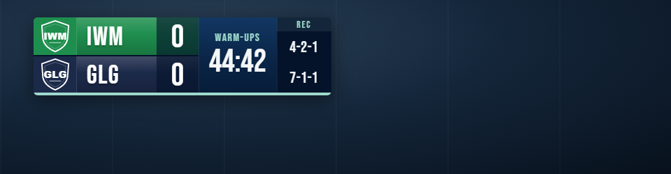
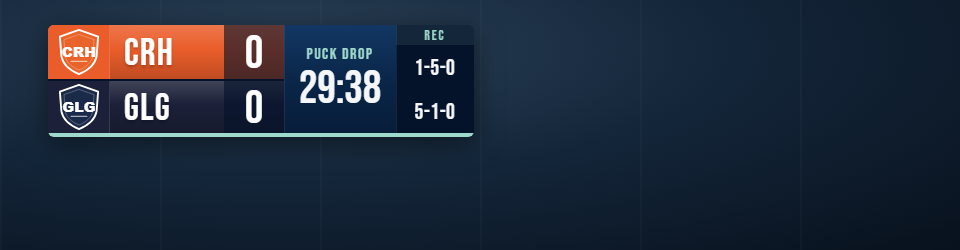

Scorekeepers sometimes run warm-ups or a flood on "Period 1" or "Intermission". Before the scheduled start that still reads PUCK DROP. If the game starts early, the first shot or goal switches the scorebug to the game.

**Cards to air** (On air → Graphics; **Preview** shows it in the panel first, **Air** puts it on OBS): matchup, pregame stats, team leaders. **Lineups:** your starting lineup (set it up under Setup → Lineups & power-play units).

### During play

Mostly hands off:

- **Goals:** the score changes the moment the scorekeeper enters it, and the goal bug goes up. The scorer and assists follow when the scorekeeper announces them, usually 10–30 seconds later. If the scorekeeper credits a goal to the wrong team and fixes it, the wrong goal disappears too.
- **Penalties:** the penalty bug names the player and the infraction from the announcement. If the scorekeeper's reason is just a placeholder, the penalty's type shows instead (MISCONDUCT).
- **Banners:** power play, penalty kill, 5-on-3 and 4-on-4 come from the penalty clocks. Your team's PP% / PK% shows briefly when an advantage starts.

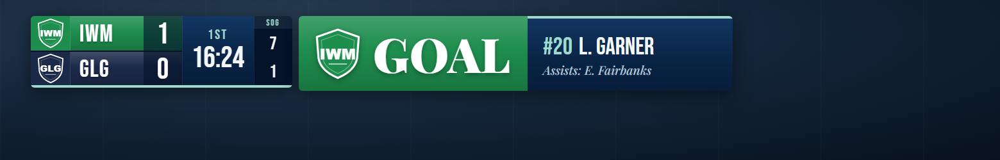
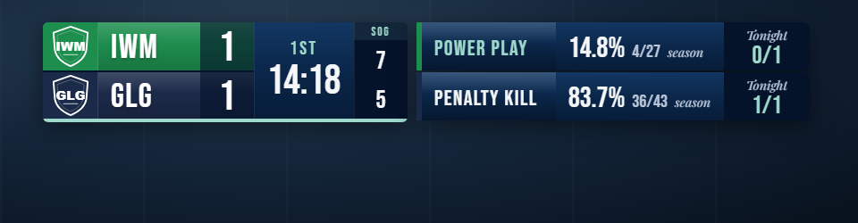

**What you do:**

- Air your **power-play unit** when it goes out (On air → Lineups), unless the Auto director is doing it.
- Save **instant replays** with **Ctrl+R** and play the latest with **Ctrl+Shift+R** (the Replays tab has the library).
- **Highlight reel** (an intermission or after the game): in the Replays tab's library, star (★) the clips you want, and trim each one: open it (click the picture), play to where it should begin and click **Start here when aired**, then to where it should stop and **End here when aired** (or use **⏩ Start** / **⏹ End** on the clip and type the seconds; 0 clears). The preview plays just that part. **▶ Air starred as highlight reel** plays them oldest first, each from its start to its end, then back to live.
- **Correct** anything that's wrong (see *When something looks wrong* below).
- **Milestones:** when a goal brings someone to a season mark (first goal or point of the season, 10th goal, 25th point, a point streak kept going, or a shutout at the final), a **Milestones** popup appears at the bottom right of the panel, on any tab. The waiting one shows in the panel's previews with a dashed frame, not on OBS. Click **Push live** when the moment is right (it waits for any goal or penalty announcement and stays up 10 seconds), or **Dismiss** it. If the goal is taken back or re-credited, its milestones go with it. Numbers come from TimeToScore's season stats plus tonight, so check the preview before airing: a jersey number change can throw them off.
- Put the **scores ticker** on for a while (On air → Scores around the league). Live games tick along by themselves.

### Intermissions

The board's intermission shows as **1ST INT**, **2ND INT**, **3RD INT** (before overtime) or **OT INT** (before a shootout). A good rhythm, and what the Auto director does: the **period summary** about 20 seconds in, **scores around the league** at two minutes, then **team leaders** (1st) or the **upcoming schedule** (2nd), and **standings** in the 2nd intermission. Leave the last two minutes clear. The period summary shows **shots by period** next to the goals.

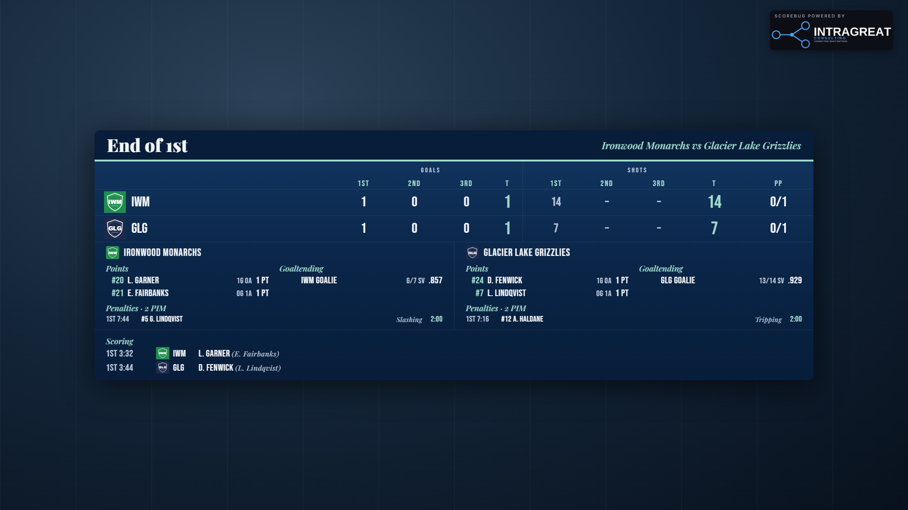

### Overtime and shootout

- Overtime runs on your league's rules (Settings → Overtime rules). At even strength the scorebug shows **3-ON-3 OVERTIME** (or 4-on-4). A penalty in 3-on-3 overtime is a 4-on-3 power play; when it ends with the clock running, it shows **4-ON-4** until the next stoppage, then 3-on-3 again, as the rule plays it.
- **Shootout:** the strip beside the scorebug shows each attempt (● goal, ✕ miss, ○ still to shoot), the round, and the winner once it's decided (**GLACIER LAKE GRIZZLIES WIN**, say), and stays up at the final. Still tied after the rounds, it goes on: **SUDDEN DEATH · ROUND 4**, and so on; after 8 rounds it shows the latest 8 with **+N** for the earlier ones.
  - **It fills in by itself:** the scorekeeper's shootout entries (goals and misses, with the shooter) are read from TimeToScore's play-by-play every 20 seconds, and goals the scoreboard counts show at once.
  - **If TimeToScore is behind or wrong** (the scorekeeper fixes it later), enter attempts on the On air tab, **Period & clock → Shootout** row (goal/miss buttons for each team, Undo). What you enter stays until TimeToScore has the same number of attempts for that team, then TimeToScore's list takes over.

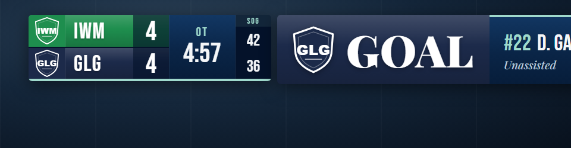
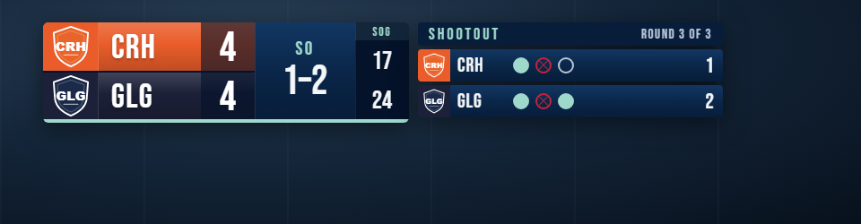

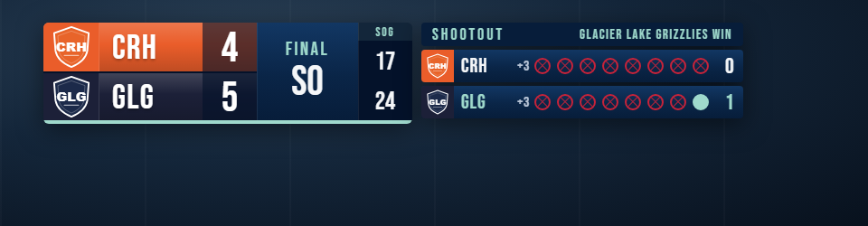

### After the final horn

The scorebug shows **FINAL**, or **FINAL over OT** / **FINAL over SO**. Air the **final summary**, the **three stars**, **player of the game** (pick or change the player under Graphics), and the **upcoming schedule**.

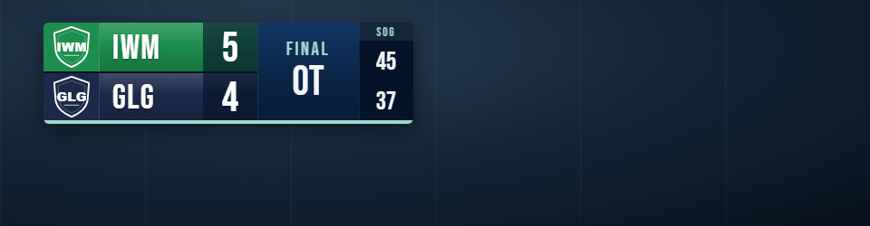

---

## A second device (laptop or iPad)

Run the panel from a laptop or iPad while the streaming PC streams: graphics, replays and their previews, lineups, scores. Hotkeys keep working on the streaming PC's own keyboard.

1. On the streaming PC: **Settings → Second device → Allow the panel from other devices**, then restart PuckBug. Windows may ask to let PuckBug on the network: allow **Private networks**.
2. On the other device (same network): open the address shown there (like `http://192.168.0.135:8770/panel`) and enter the 6-digit **PIN**. The device stays signed in for 30 days; **New PIN** signs every device out.
3. Use a private network: the rink's staff Wi-Fi or a small router of your own, not public guest Wi-Fi.

OBS and the panel on the streaming PC itself never need the PIN.

---

## On air tab, section by section

| Section | What it's for |
|---|---|
| **Graphics** | Cards: Preview, then Air; Hide card. The **Auto** button and what it's doing next. Player of the game picker |
| **Lineups** | Starting lineup, all lines, power-play units, for either team |
| **Scores around the league** | Tick the games, the scores band, the ticker, Update scores |
| **Instant replay** | Save, play, the replay buffer |
| **Score & shots** | Fix the score or shots; each number shows the scoreboard's value under it |
| **Period & clock** | Change the period, use your own clock; the **Shootout** row in overtime |
| **Strength & situations** | Force a banner, delayed penalty, timeout, empty net |
| **Penalties** | Every penalty: fix the player or infraction, take one off |
| **Goals** | Every goal: scorer, assists, tags; show the goal bug again |
| **Show / hide on air** | The clock, shots, penalties, banners, goal bug, the whole scorebug |
| **Log** | Everything that happened, newest first |

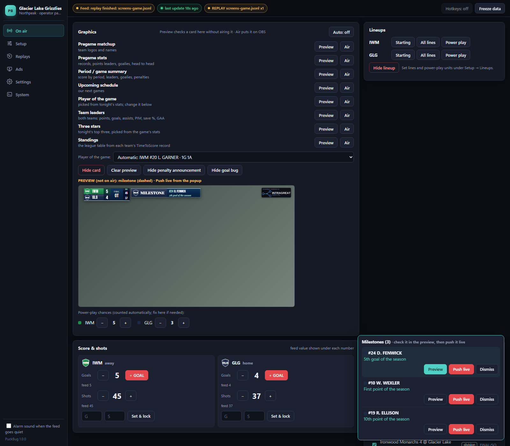

---

## Sponsors: advertising playlists

The **Ads** tab plays sponsors' images and videos on the overlay, one after another:

- **Full screen**: a break that covers the picture (1920 × 1080). It steps aside while a card or lineup is on air, so the period summary and the director's cards still air through it.
- **Lower third**: a banner above the ticker (1400 × 175).
- **Corner**: a box at the bottom right (480 × 270).

PuckBug starts with Intragreat Consulting's sample ad in each size, as three playlists to try. Delete them when you have your own.

1. **Files**: drop images (PNG, JPG, WebP, GIF, SVG) or videos (MP4, WebM) on the box, or choose them. This works from the iPad too. They're kept in `assets\ads`, and updates keep them.
2. **Playlists**: make one, pick where it shows, add files in order, and set each one's seconds. A video is set to its own length. Tick **Loop** to keep it going, and **Sound** for a full-screen video with audio. Then **Save playlists**.
3. **Plays by itself in**: tick **Pregame**, **Intermissions** or **After the final**. The playlist starts when that break begins and stops when the puck drops. **■ Stop ads** holds it off until the next break.
4. **Preview** shows a playlist in the panel's preview (dashed outline, silent) without airing it. **Go live** then airs it. **▶ Air** airs one straight away. The On air tab has the same buttons under **Advertising**.

**Sponsored moments** (Ads tab): put a sponsor's logo with "PRESENTED BY" on the graphics you pick. Each one is optional, and a wide logo (about 4 × 1) reads best.

| Moment | Where the sponsor shows |
|---|---|
| Power play | On the **POWER PLAY** announcement, with the sponsor's lower third just before and just after it (pick the playlist and the seconds) |
| Goals | Beside the goal announcement |
| Shutouts | Under the SHUTOUT banner at the final, and beside a shutout milestone |
| Three stars, Player of the game, Period and final summary, Standings, Team leaders, Upcoming schedule, Pregame matchup | Under the card |
| Starting lineups, Scores around the league | Under the band |
| Shootout | Under the shootout strip |
| Milestones | Beside the milestone announcement |

**POWER PLAY announcement**: when the home team goes on the power play, a POWER PLAY graphic follows the penalty announcement. It names who's in the box and the power play's numbers (season and tonight). Set it to our team's power plays, both teams', or off at the top of Sponsored moments. When it's off for a team, that team's power plays show the PP% / PK% pop-out as before.

**Playing and stopping** (Ads tab and On air → Advertising):

- **▶ Air (loop)** keeps a playlist going until you stop it. **▶ Once** plays it through one time, then it comes off. **Preview** checks it in the panel first, then **Go live**.
- **Now playing** shows the item on air, the time left, and a progress bar. Click any item's picture to jump to it.
- **⏮ Previous**, **↺ Restart item**, **⏸ Pause** / **▶ Resume** (a video holds on its frame), **⏭ Next**.
- **⏹ Stop after this item** lets the current ad finish. **■ Stop now** fades it off.
- **Stop in 1, 2, 5 or 10 min** sets a stop time for the break; **No stop time** clears it.
- **Auto: ON / OFF** decides whether playlists set for breaks start by themselves.
- **Files**: **▶ Air** puts a single file up on its own (as full screen, lower third or corner) until you stop it, and **Preview** checks it first.

**Hotkeys** can run them too: under **Settings → Hotkeys**, pick *Air an ad playlist* (and which), *Stop ads*, *Stop ads after this item*, *Pause / resume ads*, *Next ad* or *Previous ad*.

**Powered-by watermark**: the overlay shows "Scorebug powered by" with the Intragreat Consulting logo in the top right, where no other graphic goes. Only a full-screen ad covers it. To remove it, enter your code under **Settings → Powered-by watermark**. Once unlocked, that PuckBug keeps it off through restarts, and the same box can show or hide it again.

---

## The Auto director (optional)

Turn it on with the **Auto** button (On air → Graphics) or under **Settings → Auto director**, where each step can be switched off. It never airs anything while something else is up (a card, lineup, scores band, goal or penalty announcement). It waits, and it only takes down what it put up. Each step runs once per game, and **New game** starts it over. If you turn it on late, moments that have passed are skipped, not aired late.

| When | What | How long |
|---|---|---|
| 20 min before the scheduled start | Matchup card | 20 s |
| 15 min before | Pregame stats | 30 s |
| 10 min before | Team leaders | 25 s |
| 6 min before | Scores around the league | 12 s a page |
| 2 min before | Starting lineups, away then home | 12 s each |
| 17:00 of the 1st | Your lines | 6 s a line |
| Each of your power plays | Your power-play unit | 6 s a unit |
| The 2nd period | Scores ticker | the period |
| 20 s into each intermission | Period summary | 40 s |
| 2:00 into each intermission | Scores around the league | 12 s a page |
| 5:00 into the 1st / 2nd intermission | Team leaders / upcoming schedule | 25 s / 20 s |
| 8:00 into the 2nd intermission | Standings | 25 s |
| 15 s after the final horn, one after another | Final summary, three stars, player of the game, scores, upcoming schedule | 50 s, 25 s, 20 s, pages, 20 s |

Intermission steps follow the scoreboard's intermission clock (a rink without one: 15 minutes by the wall clock) and only start once the game has begun (a flood before puck drop doesn't count). Steps with nothing to show are skipped: lineups need your lines set, scores need Update scores, and a card with nothing in it (no upcoming games yet, no season stats) isn't aired. Your power-play unit waits for the penalty and POWER PLAY announcements to finish, then airs while the power play lasts. The Auto director never airs a milestone: those are always your call.

**Is it on?** One click on **Auto** turns it on (a second click a moment later is ignored, so a double click doesn't switch it straight off). Next to the button it says what it's airing or what's next. The pregame steps need the game's start time: load tonight's game from the schedule (Setup → Game setup); a pasted game link has no start time, and the status says so.

---

## Hotkeys

They work in every window, OBS included. Remove the same keys from OBS's own hotkeys so both don't fire.

**Change them under Settings → Hotkeys:** click a key combination and press the new one (PuckBug's hotkeys hold off while you do, so pressing Ctrl+H there doesn't add a goal), pick what it does and for which team, then **Save hotkeys**: they work at once. **+ Add hotkey** adds one, ✕ removes one, **Reset to defaults** puts them all back. A warning marks keys other programs use: Ctrl+A is Select all, Ctrl+C Copy, Ctrl+T a new tab. Pressing one of those in another program fires PuckBug's hotkey too, so for goals a key nobody else uses (Ctrl+Shift+…, the number pad, F-keys) is safer. After the final, a goal key does nothing.

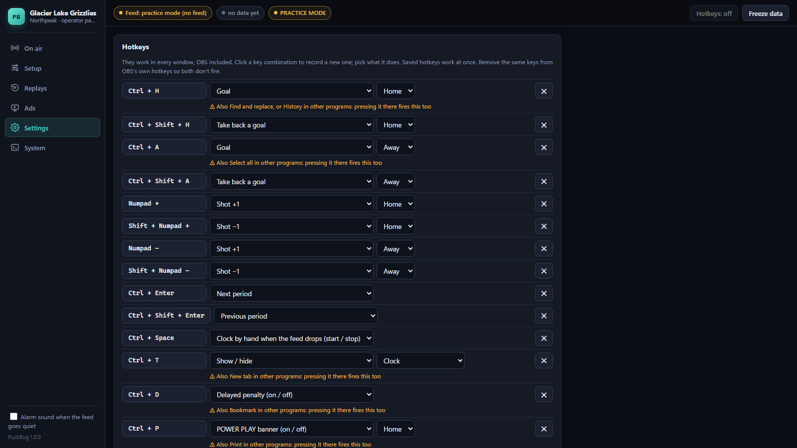

The defaults:

| Keys | Does |
|---|---|
| Ctrl+H / Ctrl+A | Goal, home / away |
| Ctrl+Shift+H / Ctrl+Shift+A | Take back a goal, home / away |
| Numpad + / Numpad − | Shot, home / away (with Shift: take one back) |
| Ctrl+Enter / Ctrl+Shift+Enter | Next / previous period |
| Ctrl+T | Show or hide the clock |
| Ctrl+D | Delayed penalty |
| Ctrl+P / Ctrl+K | Power play banner, home / away |
| Ctrl+5 / Ctrl+3 | 5-on-3, home / away |
| Ctrl+4 | 4-on-4 |
| Ctrl+X / Ctrl+E | Empty net, home / away |
| Ctrl+6 / Alt+6 | Timeout, home / away |
| Ctrl+R / Ctrl+Shift+R | Save a replay / play the latest |
| Ctrl+Space | Feed dropped: run the clock by hand from where it froze (press again to stop it at a whistle); it follows the scoreboard again when the feed is back |

On a Mac, the same keys work once Terminal is allowed under **System Settings → Privacy & Security → Accessibility** (and Input Monitoring if it's listed). Hotkeys can be paused from the panel (the button in the top bar).

---

## When something looks wrong

| What you see | What to do |
|---|---|
| The score is wrong | Type the right number under **Score & shots** and click **Set & lock**: yours stays until you click **Use feed** (back to the scoreboard's). Each number shows the scoreboard's value under it |
| A goal has no name | The announcement may not have come yet. TimeToScore's play-by-play names it too, within about 20 s of the scorekeeper entering it. Or fill the scorer in under **Goals** |
| A goal bug for a goal the scorekeeper took back | It disappears when the scoreboard takes the goal back. If not, take it back with Ctrl+Shift+H / A |
| A penalty with no reason | Fill it in under **Penalties** |
| A penalty shot | Nothing to do: a penalty shot (0:00, "Penalty Shot" or "PS") puts no one in the box and starts no power play. Enter one by hand with the **Penalty shot** type |
| A goal shows an assist named "Unassisted" | It won't: "Unassisted", "none", "UA" or "-" where the assists go means no assist |
| A goal key pressed after the final | Ignored (Ctrl+A is "select all" in every other program, and the hotkeys work in every window). A real late goal goes in with **+ GOAL** in the panel. Goals entered by hand with no scorer beyond TimeToScore's final score are removed when the final comes in |
| The scorebug says PUCK DROP but the game is on | The game started before its scheduled time and nobody has shot yet; the first shot fixes it. Or load the game with the right time |
| The game time is wrong | Settings → Current setup: a club website schedule may disagree with TimeToScore; clear it to use TimeToScore's |
| "Feed lost" / the scorebug stopped | The red **FEED SILENT** alert comes up. If play is on, press **Ctrl+Space** (or **▶ Start clock** in the alert) to run the clock by hand from where it froze, and again at each whistle; when the feed is back the scoreboard's clock takes over by itself. The internet or the rink's scoreboard dropped. PuckBug holds the last data and catches up by itself: the score from the board, and goals, scorers and penalties it missed from TimeToScore's play-by-play, at their real times (nothing airs for them). Keep the PC awake and plugged in (the Mac launcher keeps a Mac awake by itself) |
| Started PuckBug late, or loaded a game that's over | Nothing to do: everything before is filled in from TimeToScore's play-by-play (goals with scorers and assists, penalties, power-play chances, shots by period; for a finished game the final score, overtime and shootout too). No goal bugs, goal light or milestones for those |
| Shootout misses aren't showing | They come from TimeToScore's play-by-play about every 20 s; if the scorekeeper is behind, enter them in the Shootout row |
| Something else | **System → Log**, and the day's log file in the `logs` folder: send it along |

---

## What it looks like

| | |
|---|---|
| 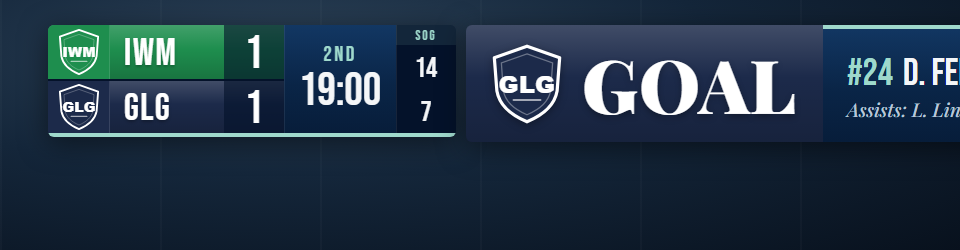 | 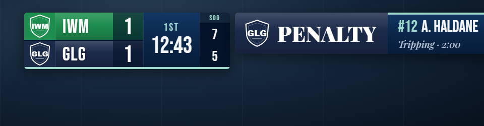 |
| 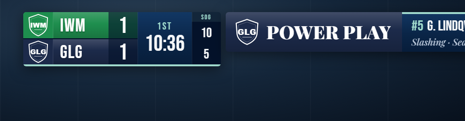 | 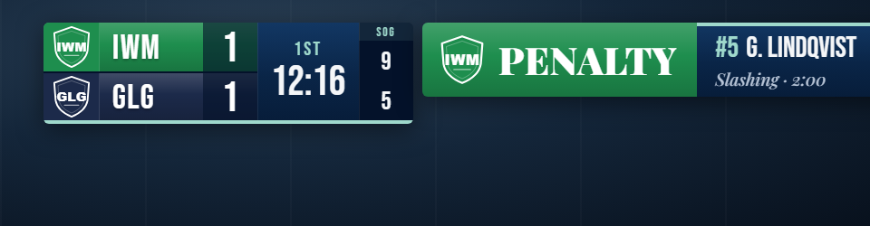 |
| 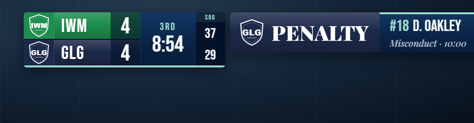 | 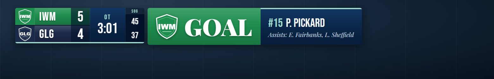 |

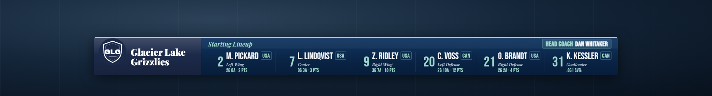
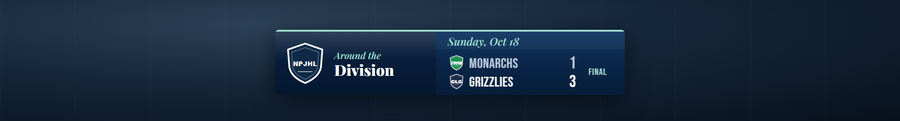
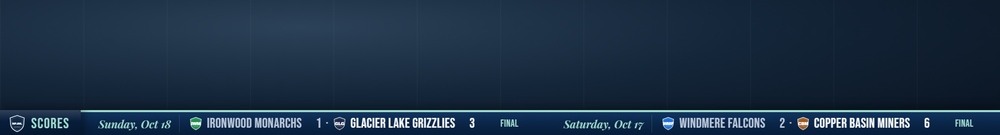

| | |
|---|---|
| 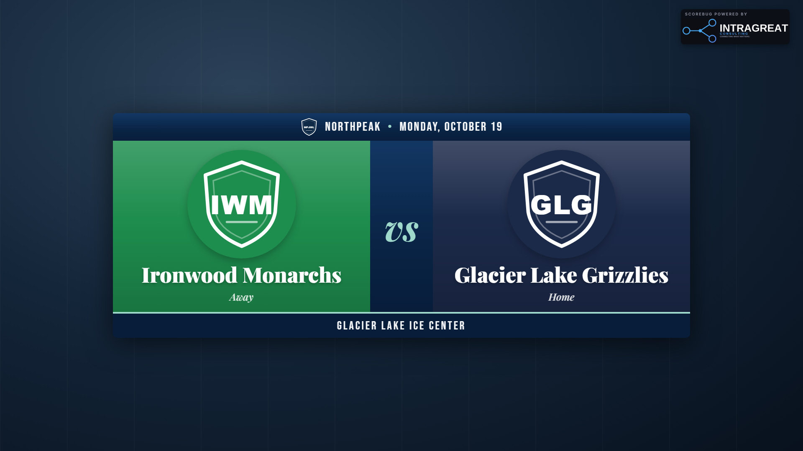 | 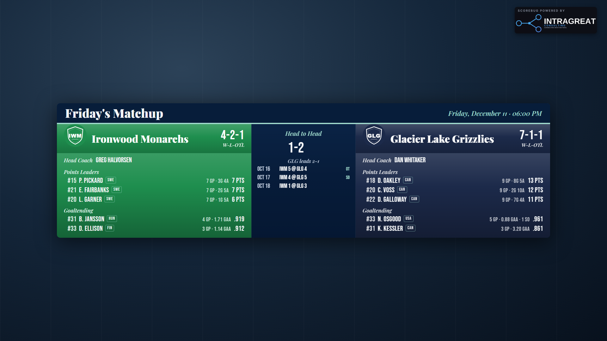 |
| 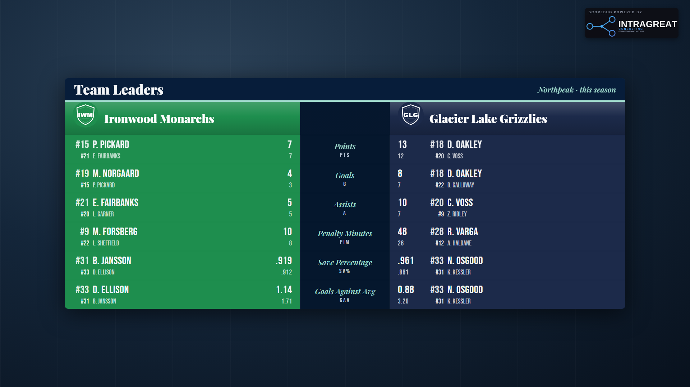 | 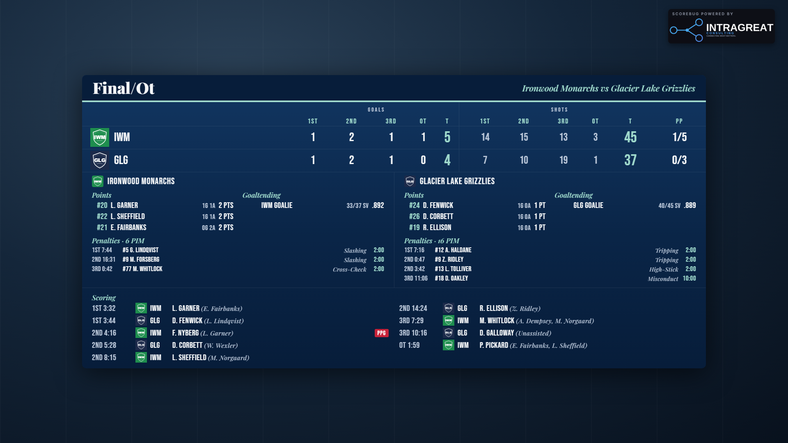 |
| 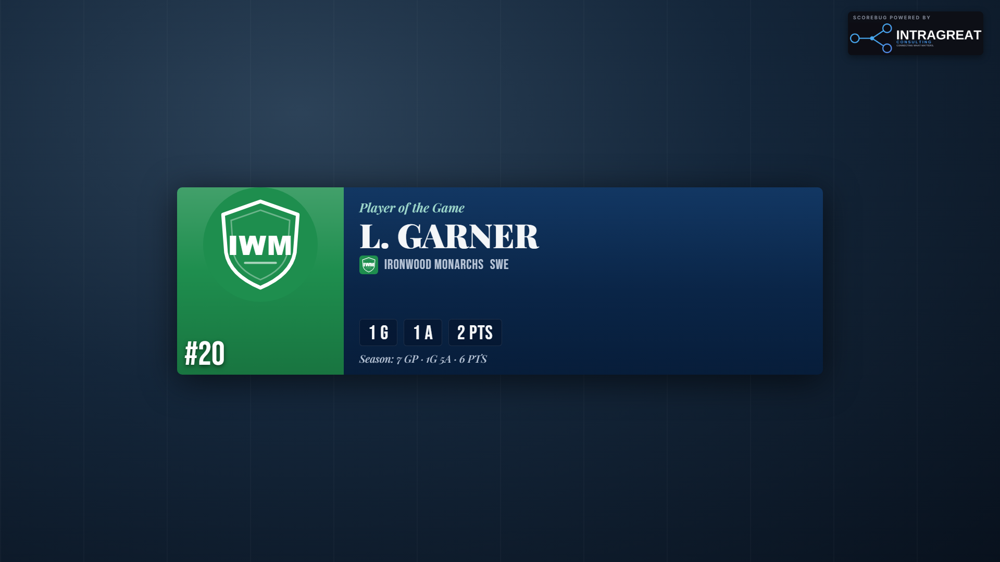 | 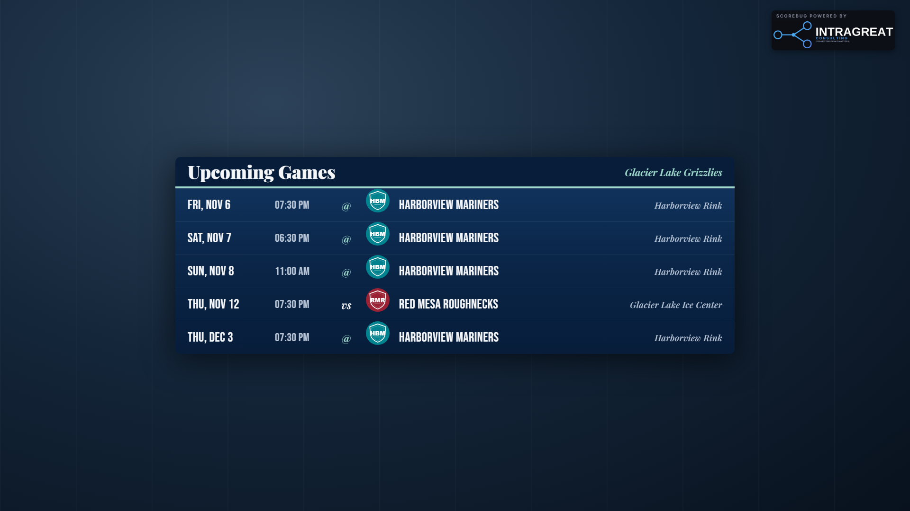 |
| 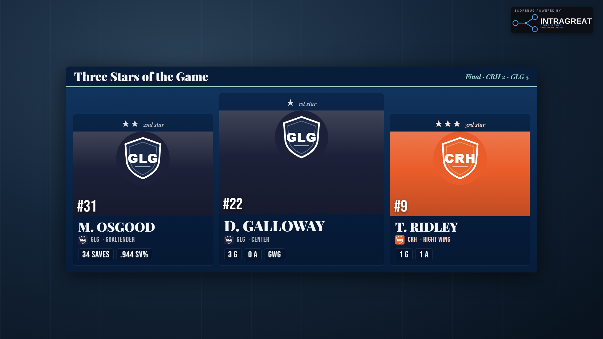 | 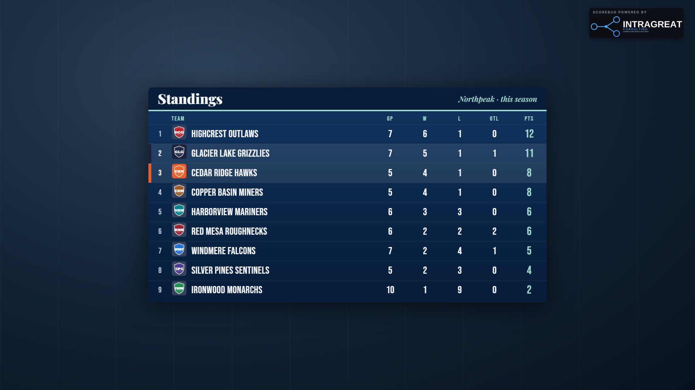 |

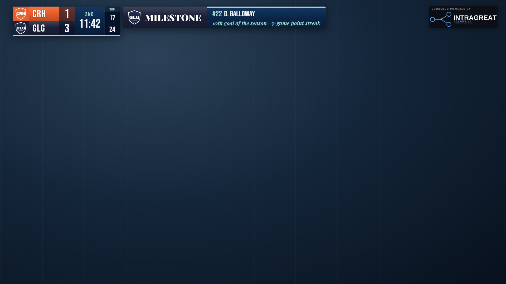
